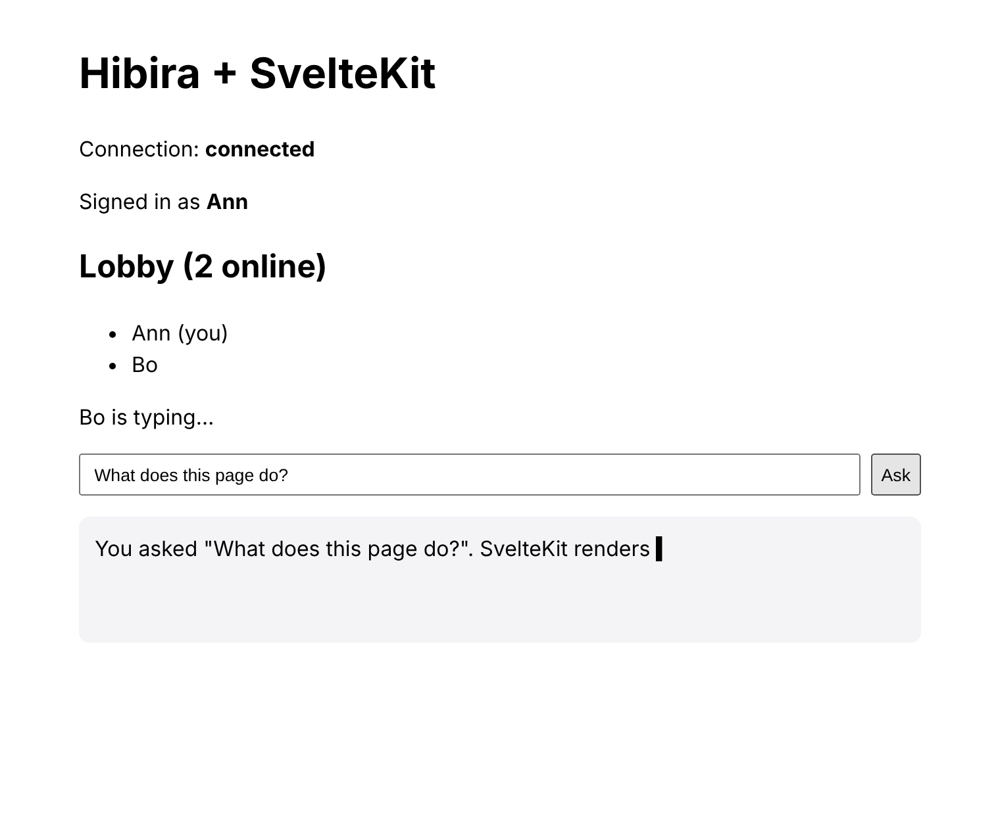

# @hibira-io/svelte

[](https://www.npmjs.com/package/@hibira-io/svelte)
[](https://github.com/hibira-io/svelte/actions/workflows/ci.yml)

Svelte stores for [pusher-js](https://github.com/pusher/pusher-js) on
[Hibira](https://hibira.io), or any Pusher-compatible server, made for
SvelteKit: one connection for the app, channels shared between components,
events, presence members, connection state and client events. It also
streams LLM output to the browser: `streamToChannel()` sends tokens from a
`+server.js` in batched events, and `useStream()` puts them back together,
for every tab and every person on the channel at once.



- Svelte 5 (runes or not) and Svelte 4. Every helper returns a plain
  `svelte/store` readable, so `$store` works in any component.
- SvelteKit server rendering safe: nothing connects on the server, and the
  first values arrive after hydration, so there are no mismatches.
- Channel names can be stores, or in Svelte 5 a getter over `$state` or
  props; the subscription follows them.
- `@hibira-io/svelte/kit`: request handlers for the channel auth and user
  sign-in endpoints pusher-js calls.
- Works with Laravel Echo: pass `echo.connector.pusher` as the client.
- Plain ESM with TypeScript types, no build step, no dependencies besides
  `pusher-js`.

Using React or Vue? See [@hibira-io/react](https://github.com/hibira-io/react)
and [@hibira-io/vue](https://github.com/hibira-io/vue).

## Install

```sh
npm install @hibira-io/svelte pusher-js
npm install pusher   # for the server side: auth endpoint and streamToChannel
```

## Setup

Create the instance once, in the root layout, and put it in context:

```svelte
<!-- src/routes/+layout.svelte -->
<script>
  import { env } from '$env/dynamic/public';
  import { createHibira, setHibira } from '@hibira-io/svelte';

  let { children } = $props();

  setHibira(
    createHibira({
      appKey: env.PUBLIC_HIBIRA_KEY,
      options: {
        channelAuthorization: { endpoint: '/api/hibira/auth', transport: 'ajax' },
      },
    }),
  );
</script>

{@render children()}
```

`options` are pusher-js options merged over the Hibira defaults
(`cluster: 'hkg'`, `wsHost: 'ws.hibira.io'`, TLS on). The connection opens
the first time a store is subscribed in the browser; on the server
`usePusher()` is `null` and every store keeps its empty value.

Already using Laravel Echo? Hand its client over instead of an app key:
`createHibira({ client: () => echo.connector.pusher })`.

## Stores

```svelte
<script>
  import { useConnectionState, useEvent, usePresence, useTrigger } from '@hibira-io/svelte';

  let { data } = $props();

  const connection = useConnectionState();
  const room = usePresence(() => `presence-room-${data.room.id}`);
  const trigger = useTrigger(() => `presence-room-${data.room.id}`);

  let orders = $state([]);
  useEvent(() => `private-shop-${data.shop.id}`, 'order.created', (order) => {
    orders = [order, ...orders];
  });
</script>

<p>{$connection}, {$room.count} here, you are {$room.me?.info?.name}</p>
<input oninput={() => trigger('client-typing', {})} />
```

| Helper | Returns |
| --- | --- |
| `useChannel(name)` | store of the pusher-js channel (null while there is none) |
| `useEvent(target, event, handler)` | calls `handler(data, metadata)` while the component lives; returns `stop` |
| `usePresence(target)` | store of `{ members, others, me, count, channel }`; members are `{ id, info, me }`, you first |
| `useTrigger(target)` | `trigger('client-…', data)`; false until subscribed. Turn on client events for the app first |
| `useConnectionState()` | store of `initialized`, `connecting`, `connected`, `unavailable`, `failed` or `disconnected` |
| `useStream(target, options)` | store of streamed text, see below |
| `useAgentStream(target, options)` | store of a Laravel AI SDK agent run, see below |
| `useHibira()`, `usePusher()` | the instance and its pusher-js client |

`target` is a channel name, a pusher-js channel (Echo's `.subscription`), a
store of either, or in Svelte 5 a getter such as
``() => `private-order-${id}` ``. Names in a store or getter are followed:
change the value and the old channel is left, the new one joined.

A store does its work while something subscribes to it. Components that use
the same channel name share one pusher-js subscription, and the channel is
left when the last subscriber goes, so `$store` in a component is all the
cleanup there is. `useEvent` and `useTrigger` hold their channel until the
component is destroyed.

Outside a component (a `.svelte.js` module, a test), there is no context:
the helpers use the last instance created, or the one you pass as
`{ hibira }` in their options. Subscribe with `store.subscribe()` and call
the function it returns, `useEvent()`'s `stop` or `trigger.stop()` when done.

In runes mode, do not name a store `state` or `props`: `$state` and `$props`
are runes.

## Auth endpoint

Private and presence channels need an endpoint that signs the subscription.
`channelAuth()` turns a function of the request event into one:

```js
// src/lib/server/hibira.js
import Pusher from 'pusher';
import { env } from '$env/dynamic/private';
import { env as publicEnv } from '$env/dynamic/public';

export const pusher = new Pusher({
  appId: env.HIBIRA_APP_ID,
  key: publicEnv.PUBLIC_HIBIRA_KEY, // $env/dynamic/private leaves out PUBLIC_ variables
  secret: env.HIBIRA_SECRET,
  host: 'ws.hibira.io', // the host shown on your app page
  useTLS: true,
});
```

```js
// src/routes/api/hibira/auth/+server.js
import { channelAuth } from '@hibira-io/svelte/kit';
import { pusher } from '$lib/server/hibira.js';

export const POST = channelAuth(pusher, ({ locals }, { channelName }) => {
  if (!locals.user) return false; // 403
  if (channelName.startsWith('presence-room-')) {
    return { user_id: locals.user.id, user_info: { name: locals.user.name } };
  }
  return channelName === `private-user-${locals.user.id}`;
});
```

Return `false` to refuse, `true` to allow a private channel, and the member
(`{ user_id, user_info }`) for a presence channel. It reads the form body
pusher-js sends (JSON works too). `userAuth(pusher, (event, { socketId }) =>
user)` does the same for `pusher.signin()` and the `userAuthentication`
endpoint. Both only use the standard `Request` and `Response`, so they work
outside SvelteKit too.

## Streaming LLM output

Send the model's stream from a `+server.js` with `streamToChannel()`. It
takes the stream of the Anthropic, OpenAI and Gemini SDKs and the Vercel AI
SDK as they are, an async iterable of strings, or a `ReadableStream`.

```js
// src/routes/api/ask/+server.js
import { error, json } from '@sveltejs/kit';
import OpenAI from 'openai';
import { streamToChannel } from '@hibira-io/svelte/server';
import { pusher } from '$lib/server/hibira.js';

const openai = new OpenAI();

export async function POST({ locals, request }) {
  if (!locals.user) error(401);
  const { question } = await request.json();
  const stream = await openai.chat.completions.create({
    model: 'gpt-5',
    stream: true,
    messages: [{ role: 'user', content: question }],
  });
  // Don't await: answer the request now and keep streaming to the channel
  // (on a long-running Node server, such as adapter-node).
  const id = crypto.randomUUID();
  streamToChannel(pusher, `private-ai.${locals.user.id}`, stream, { id }).catch((err) => console.error('stream failed', err));
  return json({ id });
}
```

On serverless adapters, where work stops when the response is sent, await
`streamToChannel()` before returning, or use the platform's `waitUntil`.

Then in the page:

```svelte
<script>
  import { useStream } from '@hibira-io/svelte';

  let { data } = $props();
  const answer = useStream(() => `private-ai.${data.user.id}`, { rewind: true });
</script>

<p aria-busy={!$answer.done}>{$answer.text}{#if $answer.error} (stopped: {$answer.error}){/if}</p>
```

The store's value is `{ text, done, error, stream, streams, history, channel }`.
Every subscriber sees the same answer as it is written: other tabs, other
devices, teammates in a shared conversation. It follows the stream that
started last; pass `{ id }` (a value, store or getter) to follow one, or
read `streams` for all of them (by id, each
`{ id, text, done, error, meta, incomplete }`). `answer.reset()` forgets
them.

`streamToChannel(pusher, channel, source, options)` options:

| Option | Default | |
| --- | --- | --- |
| `id` | random UUID | stream id, also returned |
| `event` | `'ai-stream'` | event name |
| `interval` | `100` | ms to gather tokens into one event |
| `maxBytes` | `3500` | largest event; Free plans allow 4 KB per message |
| `meta` | | JSON sent with the first event (model, message id, author) |
| `pick` | | `(chunk) => text` for a source it does not know |
| `socketId` | | leave out the sender's own connection |
| `signal` | | an `AbortSignal` to stop; subscribers get `error: 'aborted'` |

It resolves to `{ id, text, events }` once the last event is sent, and
rejects when the source or the HTTP API fails, after telling subscribers.

Tokens are batched into one event per `interval`, so a model writing 50
tokens a second sends about 10 events a second rather than 50. Each event
carries a sequence number and `useStream()` applies them in order. The last
event carries the whole text when it fits in one message, so someone who
subscribed halfway through still ends with the full answer; otherwise their
stream is marked `incomplete`.

### Reloads and dropped connections: `rewind`

Turn on channel history for the app (app settings in the Hibira portal,
Hobby plans and up) and pass `rewind`, and nothing is lost: a page reloaded
halfway through an answer, or a phone that lost signal for a few seconds,
picks the answer up from its first token. Each time the channel is
subscribed, `useStream()` asks the server for the events it missed
(`pusher:rewind`) and applies everything in order, without duplicates.

| `rewind` option | Default | |
| --- | --- | --- |
| `seconds` | `300` | history asked for on the first subscription (the app's history window caps it) |
| `limit` | all kept | at most this many events |
| `timeout` | `5000` | ms to wait for the server before going on without history |

`history` in the store's value is the last answer: `{ count, window,
complete }`, or `{ error }` when history is off or not in the app's plan
(the stream then works as without `rewind`).

Use a private or presence channel for anything personal, so only the people
your auth endpoint allows can subscribe.

## Laravel AI SDK agents: `useAgentStream`

For agents built with the [Laravel AI SDK](https://github.com/laravel/ai)
and broadcast with [`hibira-io/laravel`](https://github.com/hibira-io/laravel)
(`broadcastOnQueue(..., AgentChannel::user($user))`):

```svelte
<script>
  import { useAgentStream } from '@hibira-io/svelte';

  let { data } = $props();
  const agent = useAgentStream(() => `private-hibira-ai.user.${data.user.id}`, { rewind: true });
</script>

{#each $agent.toolCalls as call (call.id)}<p>🔧 {call.name}</p>{/each}
<p>{$agent.text}</p>
```

The value is `{ text, reasoning, status, done, error, toolCalls, approvals,
run, runs, history, channel }`. `status` is `idle`, `streaming`,
`awaiting_approval`, `done` or `error`; `run.parts` lists text, reasoning
and tool calls in the order they started. Options: `invocationId` (follow
one run), `rewind`, `maxRuns` (20), `events` (extra event names).

## Testing it

`npm test` runs the stores against a fake client on Svelte 5 and 4,
compiles and mounts real components (context, `$store`, runes getters,
cleanup), and server-renders them. `npm run test:e2e` runs against a real
server (see `test/e2e/stores.e2e.mjs` for the variables), and
`test/fixtures/sveltekit` is a small SvelteKit app (the screenshot above)
that CI builds and server-renders.

## 中文摘要

`@hibira-io/svelte` 是給 Svelte 5／Svelte 4 與 SvelteKit 用的 Hibira（相容
Pusher）即時套件。每個函式都回傳標準的 `svelte/store`，在元件裡用 `$store`
即可：`usePresence` 線上名單、`useEvent` 事件、`useTrigger` 用戶端事件、
`useConnectionState` 連線狀態，`useStream` 搭配伺服器端的
`streamToChannel()` 把 LLM 的回答逐字串流到所有分頁。SvelteKit 伺服器渲染時
不會連線，也不會造成 hydration 不一致；`@hibira-io/svelte/kit` 的
`channelAuth()` 直接當作 `+server.js` 的 POST 使用，處理私人與 presence
頻道的授權。

## Licence

MIT
